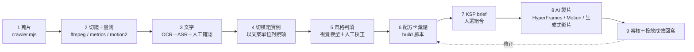

# 05｜KSP 配方庫：影片分析 → 風格拆解 → AI 製片 整體規劃

> **目的**：未來 Acer 要主打某個 Key Selling Point（KSP）時，任何人查一次就知道最適合的 **文案 × 敘事 × 風格 × 運鏡 × 影像** 組合，並附上參考片段當證據，最後可以直接交給 AI 製片流程。
> **依據**：`video analytics/`（研究計畫、pilot 報告、11 支逐鏡量測、2 支逐鏡標註、OCR／ASR），以及本 repo 的 `data/*.json`（21 支 AI 形象片敘事拆解、20 種動態效果）。
> **日期**：2026-10-15

---

## 1. 現況盤點（/audit）

### 已完成

| 項目 | 範圍 | 檔案 |
|---|---|---|
| 官方廣告清單（含觀看數） | 96 支：ASUS 89、Apple 7，2022–2026 | `video analytics/results_dedup.csv` |
| 鏡頭切分＋影像量測（fps、ASL、亮度、對比、色溫、銳利度） | 11 支 | `analysis/<id>/metrics.json`、`shots_metrics.csv` |
| 運鏡量測 v2（光流＋RANSAC） | 11 支 | `analysis/<id>/motion2.json` |
| 逐鏡人工／視覺判讀（景別、構圖、燈光、產品出鏡比例、運鏡） | **2 支**（Apple Air M5、ASUS Zenbook DUO），共 41 鏡 | `shot_annotations.csv`、`shot_analysis.html` |
| 研究設計：主題 → key spec → 模組實例 → 鏡頭 | 規劃完成，受眾已決議（個人辦公者） | `research_plan.md` |
| AI 形象片敘事拆解（13 種敘事結構） | 21 支（另一組樣本） | `data/brand-videos.json` |
| 動態效果庫＋可執行 demo | 20 種效果 | `data/motion-effects.json`、`demos/` |

### 問題清單

| 等級 | 問題 | 證據 | 影響 |
|---|---|---|---|
| [CRITICAL] | **文案層幾乎空白**。KSP → 文案的對應需要字卡與旁白原文。11 支的 ASR 只有 1 支（`8Zwuyde_8ks`）有完整旁白；多數筆電廣告本來就沒有旁白，文案全在燒錄字卡上，但 OCR 只跑了 3 支（`URwVV5tTJIA`、`bg3iEHHTGtQ`、`tLwcHZW7hS4`） | `text/*_asr.json`：5 支 0 段（可能確實沒有旁白）；`OI7iwNpZU94`、`XvbIACyf_Fc`、`mwsdihWGJNU` 只輸出「You」（Whisper 遇到純音樂時的典型幻聽）；`bg3iEHHTGtQ` 是歌詞 | 做不出「這個 KSP 用什麼文案」；**OCR 是補文案層的主要手段** |
| [CRITICAL] | **風格判讀只覆蓋 2／11 支**。景別、燈光、構圖、產品出鏡比例這些「風格」欄位，其餘 9 支只有自動數值 | `shot_annotations.csv` 只有 2 個影片 id | 配方卡的風格、運鏡欄沒有足夠樣本 |
| [CRITICAL] | **KSP 標註層（模組實例）還沒建立**。研究計畫定義了欄位，但沒有任何一筆資料 | repo 中沒有模組實例檔 | 整個系統的「索引」不存在 |
| [WARNING] | 唯一的 AI 辦公片 `tvMKIHiHBOc`（Vivobook S 15 Copilot+，71 秒）在批次清單裡，但沒有分析資料 | `batch_ids.txt` 有，`analysis/` 沒有 | 「AI 輔助辦公」是優先主題之一，卻缺樣本 |
| [WARNING] | ASR 把歌詞當成旁白 | `bg3iEHHTGtQ`（MacBook Neo）辨識出的是配樂歌詞「Smile so big that your eyes…」 | 文案欄會被歌詞汙染 |
| [WARNING] | ASR 輸出編碼不一致 | `8Zwuyde_8ks_asr.json` 是 cp950，其餘是 UTF-8 | 後續程式讀檔會出錯 |
| [WARNING] | 觀看數不能直接當「最適合」的依據 | `mwsdihWGJNU`（20 秒）1,729 萬次觀看，是同批中位數的 20 倍以上，極可能是付費投放 | 用觀看數排序會選到廣告預算，而不是好手法 |
| [WARNING] | 兩套資料用不同詞彙 | 筆電規格片用「Hook／賣點／證據／標語」；AI 形象片用 13 種敘事結構 | 要先統一，否則無法跨樣本查詢 |
| [NOTE] | CGI 運鏡仍不可靠（ASUS 50%） | `pilot_report_2videos.md` | 已知限制；CGI 鏡頭的運鏡改由人工判讀 |
| [NOTE] | 樣本中沒有 Acer 自家影片 | `results_dedup.csv` 品牌只有 ASUS、Apple | 第 2 階段補 |

**結論**：「量測」做得很扎實，但三個關鍵層都還沒填：**文案、風格判讀、KSP 標註**。這三層正好是你要的「組合」本身。下一步的重點不是再擴大樣本，而是先把 11 支影片的這三層補齊。

---

## 2. 統一資料模型

```
KSP 主題（例：日常便攜、AI 輔助辦公）
  └ key spec（最小單位：重量、續航、AI 降噪…）
      └ 模組實例 ← 系統的核心查詢單位：一段影片「怎麼表現這個 spec」
          ├ 文案單位（字卡／旁白／標語原文）
          └ 鏡頭（1 個或多個，連到 shots 的時間碼）
```

**配方卡** = 同一個 key spec 底下所有模組實例的彙總：哪些組合重複出現、出現在哪些品牌、證據強不強。

### 模組實例的五個維度（受控詞）

| 維度 | 欄位 | 受控詞（初版） | 來源 |
|---|---|---|---|
| **文案** | 原文、文案公式、語氣、數字與條件 | 公式：數字宣稱／利益句／情境問句／對比／擬人／命令句 | OCR＋ASR，人工確認數字 |
| **敘事** | 段落功能、在全片的位置、證據類型 | 功能：Hook／主張／證據／呼吸點／標語／CTA／品牌；證據：情境暗示／數字宣稱／測試展示（沿用研究計畫） | 人工＋視覺模型 |
| **風格** | 素材型態、調性、色溫、人物、場景 | 素材：實拍／CGI／螢幕錄影／字卡；調性：亮調／暗調；色溫：暖／中性／冷；人物：無／手部／半身／全身 | 自動量測＋視覺模型 |
| **運鏡** | 運鏡、景別、構圖、鏡長、剪輯節奏 | 運鏡：固定／推／拉／橫移／俯仰／環繞／跟拍／虛擬（CGI）；景別：ECU／CU／MS／MLS／WS／俯拍 | motion2 候選＋人工校正 |
| **影像** | 動態效果、證據畫面 | 動態效果：沿用 `data/motion-effects.json` 的 20 個 id；證據畫面：單手提起／放入背包／秤重字卡／厚度對比／跨時段＋電量／爆炸圖／前後對比… | 視覺模型＋人工 |

### KSP 詞表

沿用研究計畫的 15 個 key spec，再把「AI 功能」拆成可以獨立拍攝的子項（AI 是 Acer 的主訴求，一個欄位裝不下）：

| 主題（依你的優先序） | key spec |
|---|---|
| 便攜 | 重量、厚度 |
| 續航 | 續航、快充 |
| 日常效能與多工 | CPU／多工、記憶體、儲存 |
| AI 輔助辦公 | AI 視訊增強（PurifiedView）、AI 降噪（PurifiedVoice）、AI 助理／Intelligence Space、裝置端 AI 算力（NPU TOPS）、生成式 AI（文字、圖片） |
| 螢幕與視訊會議 | 螢幕、視訊／收音 |
| 次要 | 耐用、連接埠、無線連線、資安、維修／管理 |

「性價比」不列入 spec，維持為定位標籤（同研究計畫）。

---

## 3. 「最適合」怎麼定義

只用一個分數會失真，所以配方卡用三個訊號排序，並保留人工決定權：

| 訊號 | 算法 | 用途 |
|---|---|---|
| **共識度** | 同一組合在幾個「不同品牌／campaign」出現（同 campaign 的長短版只算一次） | 主要排序依據：多個品牌都這樣拍，代表是業界慣例 |
| **證據強度** | 證據類型：測試展示 > 數字宣稱 > 情境暗示；並乘上標註信心度 | 區分「看起來有說服力」與「只是氣氛」 |
| **成效參考** | 觀看數除以該頻道同期中位數；顯示但**不參與排序**，超過 10 倍的標記為「疑似投放」 | 只當旁證 |
| **法規閘門** | 數字必須有 SKU、地區、測試條件；未上市功能不能出現 | 不通過就不推薦 |

配方卡最後的呈現是「前 3 名候選組合＋每個組合的參考片段」，由人選擇，不由系統替人決定。

---

## 4. 配方卡範例（用現有資料試做，n=2，僅示範格式）

**KSP：續航**

| | 組合 A：實拍字卡型 | 組合 B：CGI 結構型 |
|---|---|---|
| 參考 | Apple MacBook Air M5，第 15 鏡（21.2–25.1 秒） | ASUS Zenbook DUO，第 8 鏡（15.2–17.0 秒） |
| 文案 | 「UP TO 18 HOURS OF BATTERY LIFE」：數字宣稱 | 「Dual Batteries, All-Day Power」：利益句 |
| 敘事 | 賣點 2，前後接手部特寫呼吸點 | 「PERFORMANCE」字卡章節下的子賣點 |
| 風格 | 實拍、亮調、暖色（約 5400K 代理值） | CGI、暗調、冷藍（約 11400K 代理值） |
| 運鏡 | 近景筆電正面、固定、3.8 秒 | 爆炸圖、推近、1.8 秒 |
| 影像 | 字卡壓在實拍螢幕上 | `exploded-view` |
| 規則提醒 | 研究計畫：續航要用「跨時段工作＋測試條件」，**電量動畫不能當量測證據** | 同左 |
| 共識度 | 1 個品牌 | 1 個品牌 |

**KSP：AI 輔助辦公（假設，待樣本驗證）**

| | 組合 A：喜劇反差型 | 組合 B：痛點解決型 |
|---|---|---|
| 參考 | Apple「Write Smarter」（口語信 → 專業信，老闆愣住） | Google Pixel 10 Magic Cue（打電話給航空公司，航班資料自動浮出） |
| 文案 | 結果導向，不講技術 | 情境＋即時解答 |
| 影像 | `text-generate` | `ui-float-cards` |
| 缺口 | 筆電規格片的樣本裡沒有（`tvMKIHiHBOc` 尚未分析） | 同左 |

---

## 5. AI 製片工作流



| 步驟 | 誰做 | 現有資產 | 要補的 |
|---|---|---|---|
| 1 蒐片 | 自動 | `crawler.mjs`、`dedupe.mjs` | 加入 Acer、AI 形象片 |
| 2 切鏡＋量測 | 自動 | `shots.mjs`、`metrics.mjs`、`motion2.py` | 無 |
| 3 文字 | 自動＋人工 | `ocr.py`、`asr.py` | 音樂／人聲偵測；統一 UTF-8；歌詞標記為 `voice_type: lyrics` |
| 4 切模組實例 | 人工為主 | 研究計畫有欄位定義 | 模組實例資料檔與標註表單 |
| 5 風格判讀 | 視覺模型＋人工 | `annotations.mjs`（2 支） | 剩下 9 支；每鏡給 8–16 格影格條帶（`strips/` 已有） |
| 6 配方卡彙總 | 自動 | `scripts/build.mjs`（可擴充） | 共識度與證據強度計算 |
| 7 brief | 人 | `docs/04` 的 brief 模板 | 改成「選 KSP → 選組合」 |
| 8 製片 | AI | `video/hyperframes-starter`（已能渲染 MP4）、20 個效果 demo | 每個配方對應一個 sub-composition 範本 |
| 9 回饋 | 人＋自動 | `fetch-youtube-stats.mjs` | 投放成效（CTR、完看率）回寫配方卡 |

---

## 6. 分階段執行

| 階段 | 內容 | 交付 | 完成標準 |
|---|---|---|---|
| **P1 補齊現有 11 支** | ① 11 支全跑 OCR，ASR 加上人聲偵測後重跑 ② 補分析 `tvMKIHiHBOc` ③ 剩下 9 支做風格判讀 ④ 建立模組實例 | 第一批配方卡：5 個優先主題 | 每個主題 ≥2 個模組實例；數字與註腳 100% 人工確認 |
| **P2 補缺口** | 依配方卡缺口補樣到約 24 支：Acer 自家 3–4 支、AI 辦公片、Dell／Lenovo／HP 商務輕薄各 1–2 支 | 配方卡 v2，共識度可以計算 | 每個優先 spec 至少有 2 個品牌的樣本 |
| **P3 查詢介面＋製片範本** | 在 AI Motion Atlas 加一個「KSP 配方」分頁：選 KSP → 看候選組合＋參考片段 → 一鍵產出 brief；每個配方做一個 HyperFrames 範本 | 可給行銷同仁使用的頁面 | 非研究人員能在 5 分鐘內產出一份 brief |
| **P4 驗證** | 用 1–2 個配方試做 45–60 秒片，做小型觀眾測試或 A/B 投放 | 配方卡加上實測成效 | 理解度、可信度有數據 |

P1 是最小可用版本：做完就能回答「續航該怎麼拍」，只是樣本少、信心低。

---

## 7. 需要你決定

1. **P1 的風格判讀要人工做多少？** 研究計畫寫的是「pilot 全數人工校對」，9 支大約 200 鏡。選項：(a) 全部人工；(b) 視覺模型先標，人工只校正低信心鏡頭與所有數字。我建議 (b)。
2. **AI 形象片要不要併入同一個配方庫？** 那 21 支（Apple Intelligence、Galaxy AI…）是「AI 功能廣告」，不是「筆電規格廣告」，但對「AI 輔助辦公」主題的參考價值最高。我建議併入，用 `sample_type` 欄位區分。
3. **成效資料來源**：Acer 自家投放的 CTR、完看率能不能取得？有的話，P4 的回饋迴圈才有意義。
